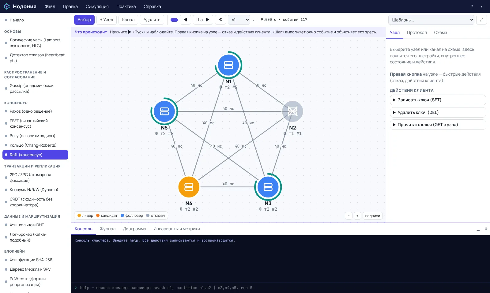

<div align="center">


# Нодония

**Открытый симулятор распределённых систем и блокчейна в браузере — для студентов, преподавателей и инженеров.**

Сайт: <https://nodonia.ru/> · Симулятор: <https://nodonia.ru/nodonia/>

[](LICENSE)




</div>

---

## Содержание

1. [Что это](#что-это)
2. [Возможности](#возможности)
3. [Быстрый старт](#быстрый-старт)
4. [Публикация на статическом хостинге](#публикация-на-статическом-хостинге)
5. [Структура репозитория](#структура-репозитория)
6. [Тесты](#тесты)
7. [Как добавить свой протокол](#как-добавить-свой-протокол)
8. [Безопасность и приватность](#безопасность-и-приватность)
9. [Лицензия и отказ от ответственности](#лицензия)

## Документация

- 📘 [`docs/Пособие_Нодония.docx`](docs/Пособие_Нодония.docx) — учебно-методическое пособие: теория, лабораторные работы, задания, глоссарий, тесты с ответами.
- 🛠 [`docs/Техническая_документация.md`](docs/Техническая_документация.md) — архитектура движка, API протоколов, модель данных, тесты, публикация.

## Что это

«Нодония» — учебный симулятор, в котором узлы обмениваются сообщениями по ненадёжной сети, а вы вносите сбои и смотрите, как реагируют алгоритмы: Raft, Paxos, PBFT, gossip, CRDT, 2PC/3PC, кворумы, PoW, PoS, смарт-контракты, архитектуры сервисов. Всё это **ванильные HTML/CSS/JS, без сборки, без фреймворков и без бэкенда**: достаточно открыть `nodonia/index.html`.

| Часть | Папка | Назначение |
|---|---|---|
| Симулятор | `nodonia/` | Приложение. Статические файлы, работает даже с `file://`. |
| Лендинг | `index.html`, `styles/`, `scripts/`, `assets/` | Публичная страница проекта. |
| Документация | `docs/` | Пособие (.docx) и техническая документация. |
| Тесты | `tests/` | Node-тесты логики и смоук-тест интерфейса (Playwright). |

## Возможности

- **Детерминированный движок событий**: виртуальное время, seed, задержки, джиттер, потери, дубли, отказ узлов, обрыв каналов, раздел сети; шаг назад и точное воспроизведение.
- **15 протоколов и моделей**: часы Лэмпорта/векторные, детектор отказов (timeout, phi), gossip, Raft, Paxos, PBFT, Bully, Ring, 2PC/3PC, кворумы N/R/W, CRDT, Kafka-подобный журнал, PoW, PoS, сервисные архитектуры.
- **Блокчейн-инструменты**: SHA-256, цепочка блоков, кошельки ECDSA secp256k1 (RFC 6979), дерево Меркла, виртуальная машина контрактов с газом, консистентное хэширование, Chord, Kademlia, математика атак.
- **Практика**: сравнение протоколов на одном сценарии (Raft, Paxos, PBFT, 2PC, 3PC, кворумная запись — 7 сценариев), 29 лабораторных, 17 заданий с автопроверкой, тест (101 вопрос), экзамен, глоссарий (109 терминов), каталог из 17 архитектурных паттернов, подбор архитектуры и калькуляторы.
- **Инварианты**: симулятор сам проверяет свойства безопасности и подсвечивает нарушения.
- **Консоль**: `crash n1`, `partition n1,n2 | n3,n4,n5`, `do put key=x value=1`, `run 10`.
- **Без слежки**: данные хранятся только в браузере.

## Быстрый старт

Самый простой способ — открыть `nodonia/index.html` двойным щелчком. Или запустить локальный сервер:

```bash
python3 -m http.server 8080
# → http://localhost:8080/        лендинг
# → http://localhost:8080/nodonia/ симулятор
```

## Публикация на статическом хостинге

Скопируйте папку целиком на любой статический хостинг (Apache, nginx, GitHub Pages). В корне лежит `.htaccess` с кэшированием, сжатием и безопасными заголовками (для Apache); для nginx перенесите правила вручную. Контакты, реквизиты поддержки и адрес репозитория на лендинге меняются в одном файле — `scripts/config.js`.

## Структура репозитория

```
nodonia/            симулятор
  index.html        подключает скрипты по порядку
  scripts/core/     util (RNG, куча, SHA-256), sim (движок), scheme, console, ecdsa
  scripts/proto/    протоколы (по файлу на протокол)
  scripts/chain/    ledger, merkle, vm — логика блокчейна
  scripts/ui/       kit, timeline, cluster, app и рабочие области (ws-*.js)
  scripts/content/  лабораторные, задания, тесты, глоссарий, справка, шаблоны
  styles/base.css   светлая и тёмная темы
assets/             логотип, шрифты, скриншоты, демо
docs/               пособие и техническая документация
tests/              тесты
```

## Тесты

```bash
node tests/run_all.js                                   # логика, протоколы, контент (22 набора)
NODE_PATH=<путь к playwright> node tests/ui_smoke.js    # браузерный смоук-тест
```

Тесты проверяют безопасность протоколов (в том числе сценарии, где она должна нарушаться при выходе за допущения), воспроизводимость, криптографию, математику атак, а также то, что каждое задание решаемо.

## Как добавить свой протокол

Протокол — один файл, который вызывает `ND.registerProtocol({ id, title, group, onMessage, onTimer, invariants, ... })`; подробности и пример — в [технической документации](docs/Техническая_документация.md). Добавьте `<script>` в `nodonia/index.html`, и протокол появится в меню.

## Безопасность и приватность

Серверной части нет, внешние CDN и трекеры не используются. Схемы, результаты и настройки лежат в `localStorage` браузера. Криптография в симуляторе — учебная модель: **не храните в ней реальные средства**.

## Лицензия

GNU AGPL-3.0-or-later, см. [LICENSE](LICENSE). Программа предоставляется «как есть». Названия технологий принадлежат их владельцам и используются только для описания идей. Протоколы упрощены и не заменяют промышленные реализации.

Автор: Giocatory · <https://github.com/Giocatory> · python@derkunov.ru
